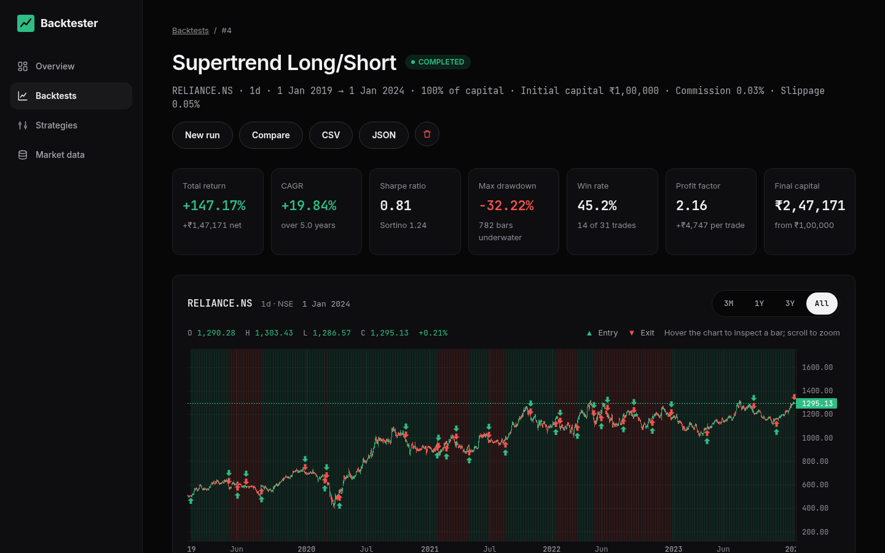
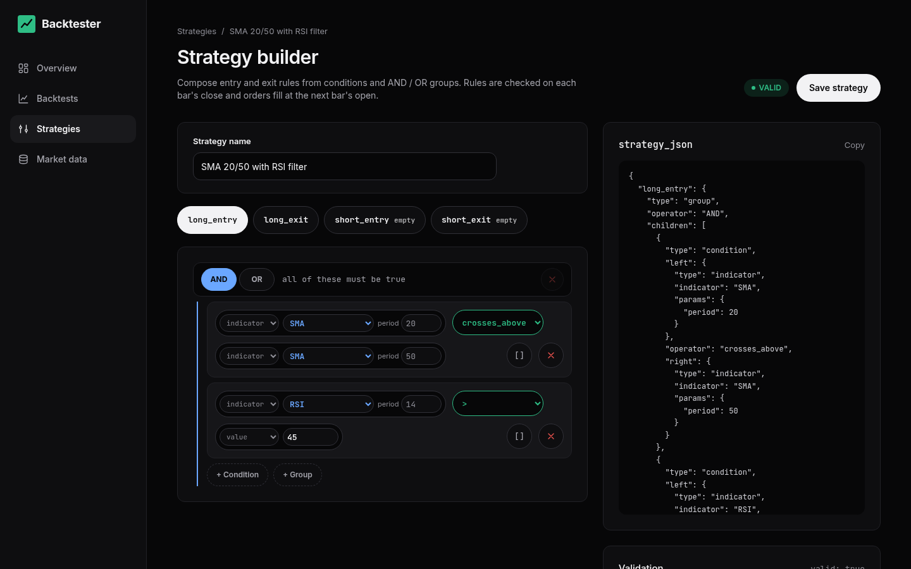
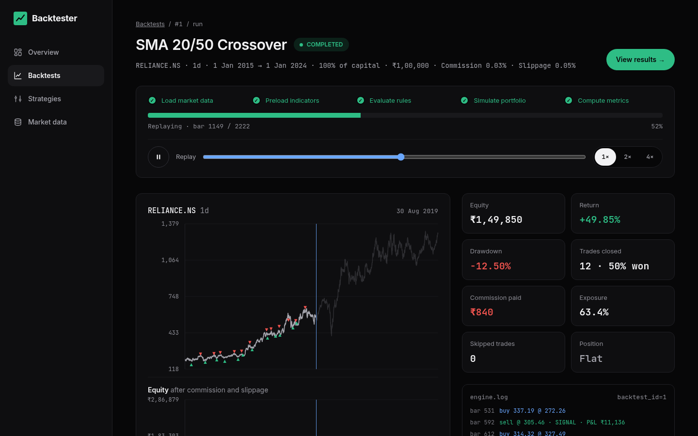
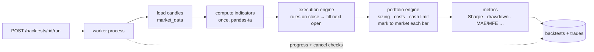

# Backtester

Backtest rule-based trading strategies on NSE stocks and indices. Compose entry and exit rules from 24 technical indicators with nested AND / OR groups, run them against historical candles with realistic costs, and study the results: equity curve, drawdown, risk metrics, monthly returns and every trade.



- **Strategy builder.** Rules are trees of conditions (`SMA(20) crosses_above SMA(50)`) and AND / OR groups, for long and short entries and exits. Every strategy is plain JSON.
- **Honest simulation.** Signals are read on a bar's close and filled at the next bar's open. Commission and slippage apply to every fill, positions never cost more than the account holds, and equity is marked to market on every bar.
- **Live runs.** Backtests run in worker processes with real progress and cancellation; when one finishes you can replay it bar by bar.
- **Analysis.** Candles with entry/exit markers, equity and drawdown in sync, Sharpe / Sortino / Calmar, MAE / MFE per trade, cost breakdown, monthly returns, and side-by-side comparison of runs.
- **Market data.** Daily, weekly and intraday (1m–60m) candles for 112 NSE symbols, downloaded from Yahoo Finance.

| Strategy builder | Run replay |
|---|---|
|  |  |

## Quick start with Docker

Needs Docker with Compose.

```bash
cp .env.example .env
# set JWT_SECRET_KEY in .env, e.g. to the output of:
python3 -c "import secrets; print(secrets.token_urlsafe(48))"

docker compose up --build -d

# Load some market data (a few seconds for one symbol; see "Market data" below)
docker compose run --rm api python main.py --symbols RELIANCE.NS,TCS.NS,^NSEI --timeframes 1d,1wk
```

Open <http://localhost:8080>, create an account, build a strategy and run a backtest. The API is at <http://localhost:8000> with interactive docs at <http://localhost:8000/docs>.

Ports, the Postgres password and the number of backtest workers can be changed in `.env` (see [.env.example](.env.example)).

## Local development

Needs Python 3.13, Node 20 and PostgreSQL.

**Backend** (FastAPI, SQLAlchemy, Alembic, pandas-ta):

```bash
cd backend
python -m venv ../.venv && source ../.venv/bin/activate
pip install -r requirements.txt
cp .env.example .env            # set DB_URL, TEST_DB_URL and JWT_SECRET_KEY
createdb backtesting_engine     # and backtesting_engine_test for the tests
python main.py --migrate-only   # create the schema
python main.py --symbols RELIANCE.NS --timeframes 1d   # some data
uvicorn app.main:app --reload   # http://localhost:8000
```

**Frontend** (React 19, TypeScript, Vite, Tailwind, TanStack Query, lightweight-charts):

```bash
cd frontend
npm install
npm run dev                     # http://localhost:5173
```

Point the frontend at another API address with `VITE_API_URL` in `frontend/.env.local`. After changing the API, run `npm run gen:api` to regenerate the typed client from the backend's OpenAPI schema; CI fails if they drift apart.

## Market data

`backend/main.py` applies migrations and then downloads candles from Yahoo Finance into the `market_data` table:

| Command | What it does |
|---|---|
| `python main.py` | Full history for every supported symbol and timeframe (slow: 112 symbols × 7 timeframes) |
| `python main.py --update` | Only bars newer than what is stored; run it daily |
| `python main.py --symbols RELIANCE.NS,TCS.NS --timeframes 1d` | Limit either command to some symbols / timeframes |
| `python main.py --migrate-only` | Apply migrations and stop |

Supported symbols are listed in [backend/app/ingestion/assets.py](backend/app/ingestion/assets.py). Yahoo only serves recent intraday history (about 7 days of 1m bars, 60 days up to 30m, 2 years of 60m), and intraday tables are kept as a sliding window, so intraday backtests need recent dates. Daily and weekly history is never trimmed.

## Tests

```bash
cd backend && python -m pytest       # 144 tests
cd frontend && npm run typecheck && npm run lint && npm run build
```

Unit tests (engine, metrics, validation, indicators) need no database. API tests run against `TEST_DB_URL`, which they wipe; they skip when it is unset and refuse to run if it points at the same database as `DB_URL`. GitHub Actions runs both suites on every push and pull request ([.github/workflows/ci.yml](.github/workflows/ci.yml)).

## How a backtest runs



1. **Load** the symbol's candles for the date range.
2. **Indicators** used anywhere in the strategy are computed once over the whole series and cached.
3. **Execution engine** walks the bars: rules are evaluated on each bar's close and orders fill at the next open, so a decision never uses the bar it trades on. One position at a time; an exit can reverse straight into the opposite side; a position still open at the end closes on the last close.
4. **Portfolio engine** sizes each trade (fixed quantity or a percent of current equity, capped at what the account can afford), applies slippage to every fill and commission to both sides, and marks equity to market on every bar.
5. **Metrics** are computed from the per-bar equity curve and the trades; everything is saved with the trades.

Every stage records progress, and each checkpoint also checks for cancellation; a cancelled run saves nothing. Definitions of every metric are in the [API reference](backend/docs/api.md#metric-definitions).

## Strategy format

```json
{
  "long_entry": {
    "type": "group", "operator": "AND", "children": [
      { "type": "condition",
        "left":  { "type": "indicator", "indicator": "SMA", "params": { "period": 20 } },
        "operator": "crosses_above",
        "right": { "type": "indicator", "indicator": "SMA", "params": { "period": 50 } } },
      { "type": "condition",
        "left":  { "type": "indicator", "indicator": "RSI", "params": { "period": 14 } },
        "operator": ">",
        "right": { "type": "value", "value": 45 } }
    ]
  },
  "long_exit": {
    "type": "condition",
    "left":  { "type": "indicator", "indicator": "SMA", "params": { "period": 20 } },
    "operator": "crosses_below",
    "right": { "type": "indicator", "indicator": "SMA", "params": { "period": 50 } }
  }
}
```

`long_entry` and `long_exit` are required; `short_entry` needs a `short_exit`. Operands are indicators, price fields (`open`, `high`, `low`, `close`, `volume`) or values; operators are `>`, `<`, `>=`, `<=`, `==`, `!=`, `crosses_above` and `crosses_below`. The full format, the indicator list with parameters and every endpoint are documented in [backend/docs/api.md](backend/docs/api.md).

## Project layout

```
backend/
  app/
    api/               FastAPI routers: auth, strategies, backtests, market data, indicators
    backtesting/       runner, execution engine, portfolio engine, metrics, worker pool
    strategy_engine/   rule schemas, validation, evaluator, indicator registry
    ingestion/         Yahoo Finance download and loading
    models/ schemas/   SQLAlchemy models and API schemas
  alembic/             database migrations
  docs/api.md          API reference
  tests/               unit and API tests
  main.py              migrations and market-data loading CLI
frontend/
  src/
    api/               typed API client (generated from OpenAPI) and query hooks
    pages/             one file per screen
    components/        charts, rule views, shared UI
    lib/               formatting, strategy and results helpers
docker-compose.yml     Postgres + API + web
```

## Configuration

Backend settings come from the environment or `backend/.env`:

| Variable | Default | Purpose |
|---|---|---|
| `DB_URL` | required | PostgreSQL connection string |
| `JWT_SECRET_KEY` | required | Signs login tokens (valid 7 days) |
| `TEST_DB_URL` | unset | Database for the API tests (wiped on each run) |
| `CORS_ORIGINS` | `http://localhost:5173,http://127.0.0.1:5173` | Browser origins allowed to call the API |
| `BACKTEST_WORKERS` | `2` | Worker processes for backtests; `0` runs them inside the API process |
| `SQL_ECHO` | `false` | Log every SQL statement |
| `BCRYPT_ROUNDS` | `12` | Password hashing cost |

The API assumes a single server process: backtests left running by a stopped server are marked failed on the next start.

## Limitations

- One symbol per backtest; no portfolios across symbols.
- Orders are market orders at the next bar's open; there are no stop-loss, take-profit or limit orders yet.
- Candles are downloaded with `auto_adjust=False`, so prices are not adjusted for dividends.
- Results depend on Yahoo Finance data, which can have gaps, especially intraday.
